# Auditoría UX/UI del back-office

> Fecha: 2026-11-14 · Rama `docs/auditoria-ux` · Estado: línea base ("antes"), sin cambios de código.

## 1. Resumen ejecutivo

### Qué se auditó

Todo el back-office tal como lo usan los dos roles reales: **SUPERADMIN** (organizador) y **STAFF** (puerta del evento). Pantallas: login, dashboard, lista de eventos, wizard de creación (6 pasos), gestión de evento (6 pestañas y 8 diálogos), generador de credenciales, asistentes y comprobantes de pago, y check-in (QR y manual). Se miró en desktop, tablet y móvil, en tema claro y oscuro.

El criterio de fondo es `PRODUCT.md`: nunca perder el trabajo del organizador, un concepto = un nombre, errores en español que dicen qué pasó y cómo seguir, el staff resuelve cada ingreso en segundos y con una mano, WCAG 2.1 AA.

### Cómo

1. **Playwright** con sesiones por rol contra Supabase local: 161 capturas, métricas (axe, desbordamiento horizontal, objetivos táctiles, foco en diálogos) y recorridos de tarea cronometrados.
2. **Impeccable `critique` × 3** (formularios, operación, shell). Cada una con dos revisores independientes: uno de diseño y otro con el detector determinista inyectado en el navegador.
3. **Impeccable `audit`** técnico sobre `src/app` y los estilos globales.

### Puntuaciones

| Superficie                                        | Instrumento         | Puntaje       | Banda      |
| ------------------------------------------------- | ------------------- | ------------- | ---------- |
| Formularios de evento (wizard, gestión, editores) | Nielsen (0–40)      | **22 / 40**   | Aceptable  |
| Operación (eventos, asistentes y pagos, check-in) | Nielsen (0–40)      | **24 / 40**   | Aceptable  |
| Shell (layout, navegación, login, dashboard)      | Nielsen (0–40)      | **19 / 40**   | Deficiente |
| **Promedio de las tres críticas**                 | Nielsen             | **21,7 / 40** | Aceptable  |
| Accesibilidad                                     | Audit técnico (0–4) | 2 / 4         |            |
| Rendimiento                                       | Audit técnico (0–4) | 3 / 4         |            |
| Theming                                           | Audit técnico (0–4) | 2 / 4         |            |
| Responsive                                        | Audit técnico (0–4) | 2 / 4         |            |
| Integridad de implementación                      | Audit técnico (0–4) | 2 / 4         |            |
| **Total técnico**                                 | Audit (0–20)        | **11 / 20**   | Aceptable  |

### Los 5 problemas que más bloquean

1. **Se pierde el trabajo del organizador sin aviso** (P0). Recargar el wizard lo vacía, cambiar de pestaña en la gestión descarta lo escrito, y los diálogos se cierran con datos sin confirmar.
2. **En móvil, el flujo de evento no se puede completar.** La página desborda (662 px en gestión y 833 px en el wizard sobre 390 px), la X de los diálogos queda fuera de pantalla y el botón Guardar a más de 1.000 px del inicio.
3. **Los diálogos de gestión no son diálogos accesibles.** `DialogFrame` no tiene rol, ni foco inicial, ni trampa de foco, ni Escape. Afecta a los 8 editores, incluido "Eliminar evento".
4. **El check-in no está hecho para la puerta.** Hay tres selects antes de la cámara, el evento por defecto es arbitrario, el STAFF aterriza en métricas financieras con Check-in detrás de una hamburguesa, y el resultado es un formulario en vez de un semáforo.
5. **Las tablas esconden lo que el operador necesita.** En Eventos y Asistentes, Estado y Acciones quedan fuera de pantalla, así que el camino a Asistentes y a los pagos está en una columna que no se ve.

Detrás de casi todo hay una causa de base: PrimeNG gana a Tailwind por el orden de capas CSS (463 supresiones con `!`), Aura conserva el verde esmeralda por defecto, y la app no tiene locale `es`.

### Conteo de hallazgos

| Severidad | Cantidad | Qué significa aquí                                              |
| --------- | -------- | --------------------------------------------------------------- |
| P0        | 1        | Pérdida de datos del usuario                                    |
| P1        | 16       | Bloquea o degrada una tarea principal o la accesibilidad básica |
| P2        | 18       | Fricción real, con alternativa                                  |
| P3        | 4        | Pulido                                                          |
| **Total** | **39**   | Ya consolidados: los duplicados entre críticas están fusionados |

La propuesta es resolverlos en **8 PRs** contra `dev` (sección 6).

---

## 2. Metodología

### Roles, viewports y temas

| Eje      | Valores                                                                |
| -------- | ---------------------------------------------------------------------- |
| Roles    | SUPERADMIN (organizador), STAFF (puerta), anónimo (login)              |
| Viewport | desktop 1440×900 · tablet 768×1024 · móvil 390×844 (táctil, escala ×2) |
| Tema     | claro y oscuro (`data-theme`)                                          |

### Pantallas

Login y error de no autorizado · Dashboard · Lista de eventos (y acceso prohibido para STAFF) · Wizard (6 pasos, con errores y botón deshabilitado) · Gestión de evento (datos, formulario, paquetes, tracks y sesiones, cupones y staff, publicación) · 8 diálogos de gestión · Credenciales · Asistentes (lista, filtros, menú de estado, detalle, comprobante, anular) · Check-in (QR, manual, búsqueda, y los tres modales de resultado).

### Recorridos de tarea

Cinco recorridos con cronómetro, conteo de clics y entradas, y verificación del resultado en la base (sección 3).

### Cómo se reprodujo

- **Harness de Playwright fuera del repo, no versionado.** Tiene un `README` propio. Una opción `--base-url` permite apuntarlo a cualquier puerto de `ng serve`, y `--screen/--role/--viewport/--theme` filtran la matriz.
- **Sesiones sin Google.** Un script fija una contraseña de prueba a los dos usuarios locales (un SUPERADMIN y un STAFF) con la Admin API de Supabase local y deja un `storageState` por rol. Las sesiones expiran en una hora.
- **Salida:** una captura por combinación pantalla×rol×viewport×tema, más un `metricas.json` con axe (solo `serious` y `critical`), errores de consola, desbordamiento horizontal y objetivos táctiles menores de 44 px.
- **Críticas:** `/impeccable critique` sobre las rutas de cada superficie y `/impeccable audit` sobre `src/app`. Los snapshots quedan en `.impeccable/critique/` (local, ignorado por git).
- **Falsos positivos descartados:** 11 avisos `broken-image` del detector (todos los `` usan `[src]` de Angular), la sospecha de que `[data-theme='dark'] .x` no se aplicaba con encapsulación emulada, y la de falta de lazy loading (las 7 rutas ya lo usan).

### Datos locales usados

Solo la base local de Supabase con el `seed.sql` ficticio: eventos `e1` (STAFF asignado) y `e2` (el más completo, con asistentes pendientes y confirmados), un comprobante de pago de demostración subido para el registro pendiente de "Ana", y borradores con prefijo `[AUDIT]` creados por el recorrido 1. No se tocó producción.

### Límites

- Los pasos 2–6 del wizard se evaluaron con la línea base, no en vivo, para no crear borradores de más.
- La emulación móvil de Playwright ensancha el viewport de layout. La posición exacta de la X del diálogo conviene confirmarla en un teléfono real.
- La cámara no existe en headless: el error de cámara en todas las capturas de check-in es esperado, aunque el momento en que se muestra sí es un hallazgo (CI-1).
- No se verificó el contenido de las exportaciones CSV/Excel.
- El contraste en tema oscuro solo se midió con axe del harness.

---

## 3. Recorridos de tarea

Todos los tiempos son de ejecución automatizada, sin tiempos de lectura humanos: sirven para comparar antes y después, no como duración real. El resultado se verificó en la base local.

| Recorrido                                                       | Rol / viewport       | Clics | Entradas | Acciones | Tiempo | Resultado verificado                               |
| --------------------------------------------------------------- | -------------------- | ----- | -------- | -------- | ------ | -------------------------------------------------- |
| 1. Crear un evento desde cero y publicarlo                      | SUPERADMIN / desktop | 9     | 11       | 20       | 16,4 s | Publicado, pero solo en el segundo intento         |
| 2. Revisar el comprobante de Ana y confirmar el pago            | SUPERADMIN / desktop | 3     | 0        | 3        | 8,4 s  | `CONFIRMED`                                        |
| 2. Ídem                                                         | SUPERADMIN / móvil   | 3     | 0        | 3        | 8,7 s  | `CONFIRMED`, con el botón bajo el pliegue          |
| 3. Check-in manual de un inscrito confirmado                    | STAFF / móvil        | 5     | 1        | 6        | 10,3 s | Registro creado, tras cambiar de evento            |
| 4. Editar fases de Ticket Básico: cambiar precio y reordenar    | SUPERADMIN / desktop | 6     | 1        | 7        | 10,2 s | Precio guardado; el reorden no se puede guardar    |
| 5a. Recargar el wizard tras crear el borrador                   | SUPERADMIN / desktop | 2     | 7        | 9        | 9,3 s  | El wizard vuelve vacío; el borrador queda huérfano |
| 5b. Escribir en Datos, cambiar de pestaña y volver              | SUPERADMIN / desktop | 2     | 1        | 3        | 4,0 s  | Se pierde lo escrito                               |
| 5c. Diálogo de paquete: escribir y cerrar con X, Cancelar y Esc | SUPERADMIN / desktop | 8     | 3        | 11       | 9,1 s  | X y Cancelar descartan sin aviso; Esc no cierra    |
| 5d. Añadir un campo en Formulario y cambiar de pestaña          | SUPERADMIN / desktop | 4     | 0        | 4        | 5,4 s  | Se pierde el campo (4 → 5 → 4)                     |

### Bloqueos y confusiones por recorrido

**Recorrido 1 · Crear y publicar.** Es el flujo central y se atascó.

- Con solo los datos marcados con `*`, portada y un paquete gratis, "Publicar evento" quedó deshabilitado en el último paso. El checklist decía "falta descripción, lugar". Ni Descripción ni Lugar llevan `*` en el paso 1, así que hubo que volver atrás (FO-5).
- Con solo el título, "Crear borrador y continuar" sigue gris, sin errores visibles y con el texto "2 campo(s) por corregir", que no nombra los campos. Tras llenar todo, el botón tarda 1–2 s en habilitarse mientras valida el slug, sin indicador.
- Al llegar al paso 2 no hay indicador de que el borrador se guardó. Hay un 403 en consola durante el flujo.

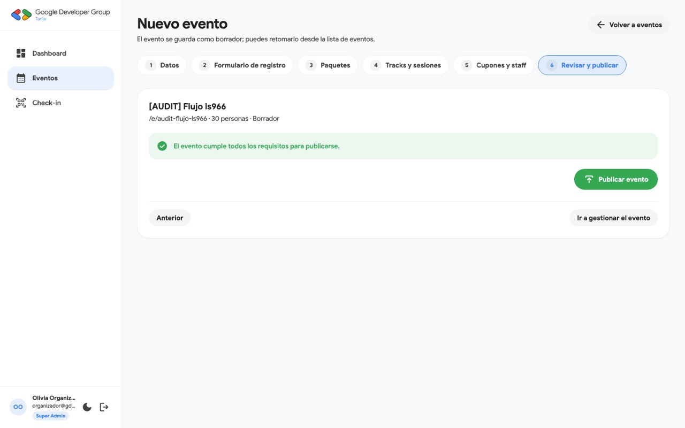

**Recorrido 2 · Confirmar un pago.** En desktop es limpio: 3 clics y "Confirmar pago" visible sin scroll. En móvil el botón queda bajo el pliegue del visor de comprobante (AS-4).

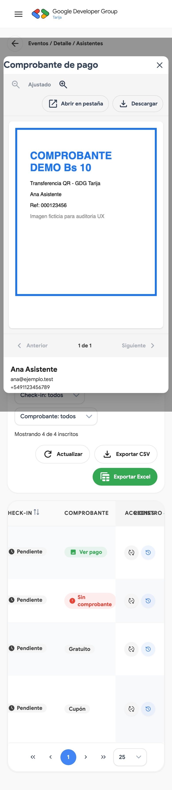

**Recorrido 3 · Check-in manual.** El evento preseleccionado fue "Cloud Study Jam (demo, virtual)", el publicado más lejano, porque la lista se ordena por fecha descendente. Para el SUPERADMIN, la preselección es un borrador del 30/12. Hubo que abrir el selector, cambiar de evento, buscar, seleccionar y confirmar en un segundo modal (CI-1).

**Recorrido 4 · Editar fases.** Cambiar el precio de la fase "Preventa" funcionó. Al reordenar (bajar la fase 1), Guardar sigue activo, pero al pulsarlo el diálogo no se cierra, Guardar se deshabilita y el error "Solo la última fase puede quedar sin cupo." aparece bajo el campo Cupo de la fase que quedó primera, dentro del cuerpo con scroll. El pie no lo explica. Solo se pudo continuar deshaciendo el reorden (FO-8).

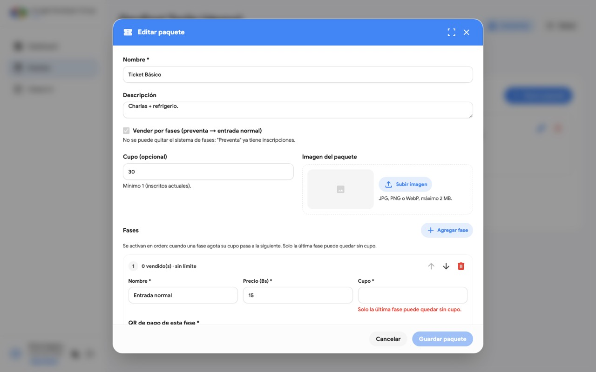

**Recorrido 5 · Pérdida de datos.** Las cuatro variantes confirman FO-1: ninguna avisa.

- **5a:** tras recargar, `/events/new` vuelve al paso 1 con el formulario vacío y la URL sin id. El borrador existe en la base, pero el wizard no puede retomarlo y queda un evento huérfano en la lista.
- **5b:** el texto escrito en Datos desaparece al ir a Paquetes y volver.
- **5c:** X y Cancelar cierran y descartan sin pedir confirmación. Esc no cierra el diálogo.
- **5d:** el indicador "Cambios sin guardar" está visible, y aun así cambiar de pestaña descarta el campo sin avisar.

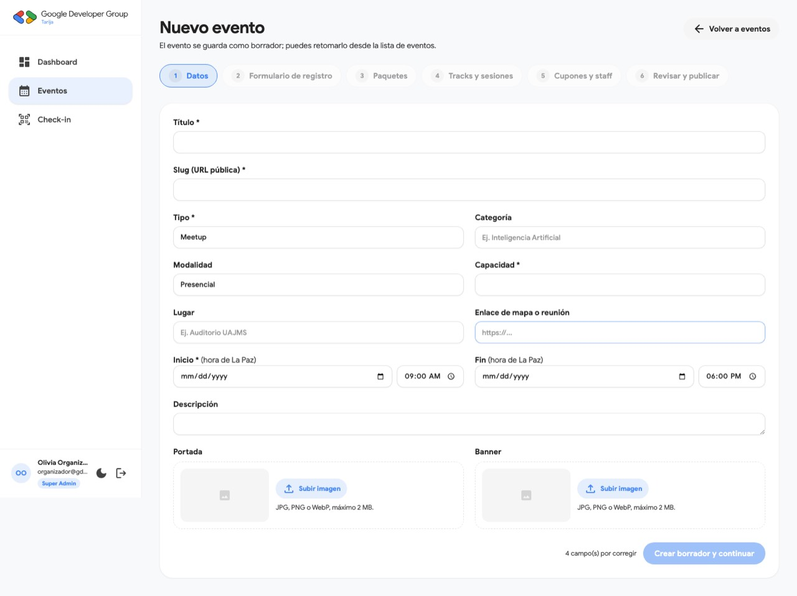
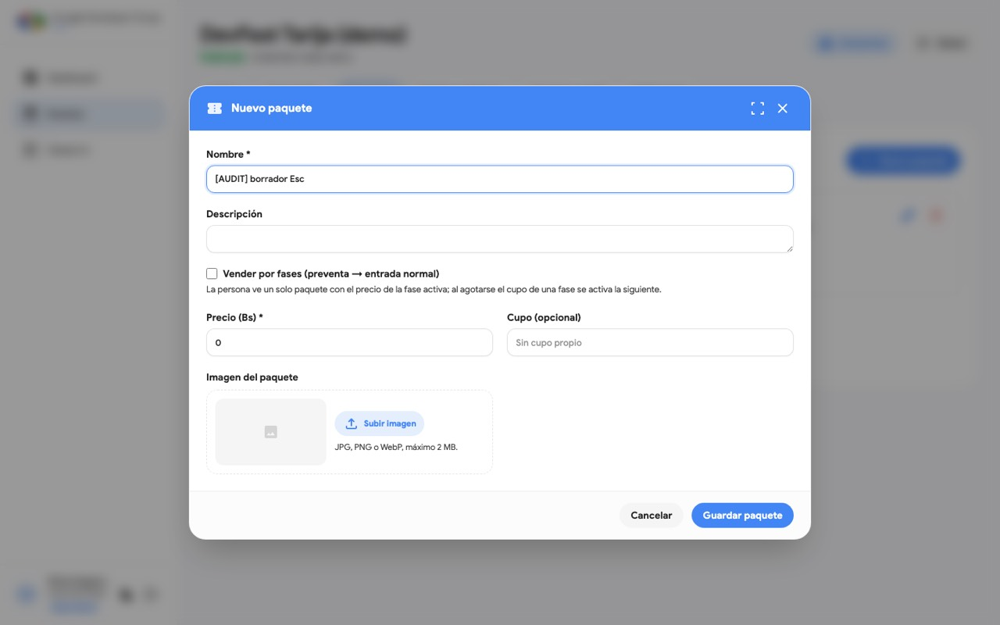

---

## 4. Hallazgos por área

**Convenciones.** `[P0..P3]` es la severidad. "PR" apunta a la asignación de la sección 6. Los comandos son los de Impeccable (`/impeccable <comando>`). Las capturas están en `auditoria-ux/`. Salvo indicación, son de la línea base en claro. Las rutas `archivo:línea` son relativas a la raíz del repo; `EV`, `AT` y `CK` son abreviaturas de las plantillas de eventos, asistentes y check-in.

### 4.1 Formularios

#### [P0] FO-1 · El trabajo del organizador se pierde sin aviso

- **Captura:** 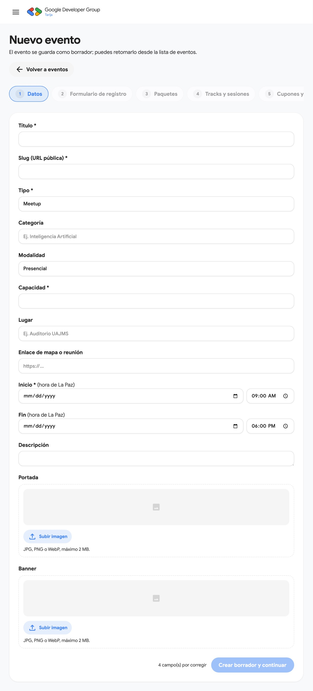
- **Ubicación:** `src/app/features/events/presentation/pages/event-wizard-page/event-wizard-page.ts:73-79` (`step` y `draft` solo en `signal()`, sin ruta ni storage).
- **Impacto:** tras recargar en el paso 1, título y capacidad quedan vacíos y "Volver a eventos" navega sin avisar. En la gestión, un campo agregado en el editor de Formulario se pierde al cambiar de pestaña, y los diálogos se cierran con datos sin confirmar. El borrador sí persiste en la base tras guardar el paso 1, pero el wizard no se puede reanudar porque no hay paso en la URL. Contradice el primer principio de `PRODUCT.md`.
- **Arreglo:** paso en la URL (`/events/new?paso=3&id=…`) y reanudar el borrador; `canDeactivate` y `beforeunload` con cambios pendientes; confirmar al cerrar un diálogo con datos o al cambiar de pestaña con el editor sucio.
- **Comando:** `/impeccable harden`, luego `/impeccable onboard`.
- **PR:** `fix/formularios-eventos` (C). El confirmar-descarte de diálogos va en `fix/dialogos` (B).

#### [P1] FO-2 · `DialogFrame` no es un diálogo accesible

- **Captura:** 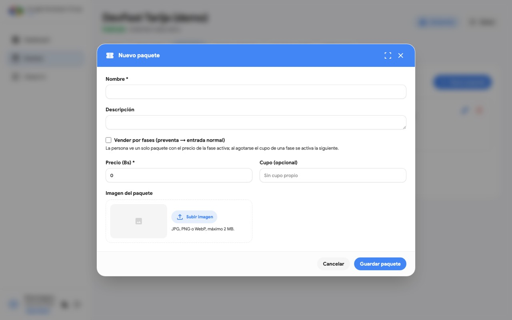
- **Ubicación:** `src/app/shared/components/dialog-frame/dialog-frame.html:1-52`, `dialog-frame.ts:18-50`; botones de cabecera sin `aria-label` en `dialog-frame.html:33`. Lo usan `ticket-types-editor`, `form-fields-builder`, `coupons-editor`, `tracks-sessions-editor` y `event-manage-page`.
- **Impacto:** sin `role="dialog"`, `aria-modal` ni nombre. El foco no entra al abrir (3 Tab recorren el fondo), no hay trampa de foco, Escape y clic fuera no cierran, y Enter no guarda porque el botón está fuera del `<form>`. El harness da `hasRoleDialog: false` y `focusEscapedWithTab: true` en los 8 diálogos. Los `p-dialog` (credenciales, detalle, comprobante, check-in) sí pasan. Incluye "Eliminar evento". WCAG 4.1.2, 2.4.3, 2.1.2.
- **Arreglo:** reescribir sobre `p-dialog` (o `<dialog>`): foco inicial, trampa, Escape, retorno del foco, `aria-label` en cerrar y pantalla completa, botones de 44 px, y `form="id"` en Guardar para que Enter funcione. Añadir confirmación de descarte si el formulario está sucio.
- **Comando:** `/impeccable harden`, `/impeccable adapt`.
- **PR:** `fix/dialogos` (B).

#### [P1] FO-3 · Desbordamiento horizontal en móvil en todo el flujo de evento

- **Captura:** 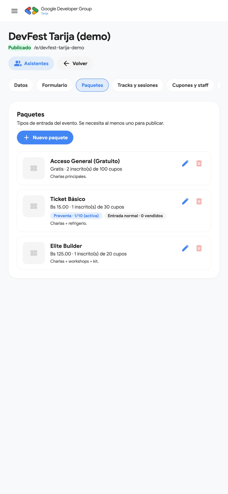
- **Ubicación:** `src/app/layouts/admin-layout/admin-layout.html:136` (`flex flex-1 flex-col md:pl-64` sin `min-w-0`); stepper y pestañas con `overflow-x-auto` dentro de ese contenedor.
- **Impacto:** `scrollWidth` 662 en gestión (todas las pestañas y diálogos) y 833 en el wizard, sobre 390 px, en 24 pantallas. Los inputs llegan a 734 px y la X del diálogo queda fuera. Es el usuario declarado en `PRODUCT.md` (organizador en el celular) quien no puede completar el flujo. WCAG 1.4.10.
- **Controles inalcanzables (medido):** Playwright no pudo tocar 23 controles en 12 pantallas a 390 px, porque el viewport de layout se ensancha (833 px en el wizard, 662 en la gestión) y el control queda a la derecha de lo visible. Ejemplos: "Siguiente" en los pasos 3–6 del wizard (x=688 sobre 390), "Crear borrador y continuar" (x=562), las pestañas "Cupones y staff" y "Publicación", "Editar paquete" (x=520) y "Nuevo track" (x=469). En `/events` a 390 px, Credenciales, Asistentes y Gestionar están en x=1186–1524.
- **Arreglo:** `min-w-0` en el contenedor del layout. Después revisar stepper y pestañas (scroll propio con indicio visual) y los grids sin colapso, y re-correr la medición de controles inalcanzables hasta que quede vacía.
- **Comando:** `/impeccable layout`, `/impeccable adapt`.
- **PR:** `fix/ui-base` (A) para el `min-w-0` del layout, una línea que desbloquea el resto; `fix/formularios-eventos` (C) para stepper, pestañas y diálogos del flujo de evento. En `/events` lo cubre D (NA-4).

#### [P1] FO-4 · Las pestañas de gestión no se alcanzan con teclado

- **Captura:** 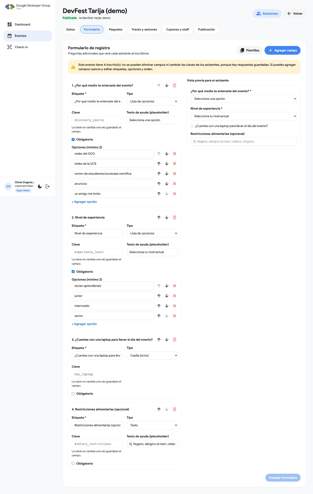
- **Ubicación:** `src/app/features/events/presentation/pages/event-manage-page/event-manage-page.html:75-95` (`tabindex` rotativo sin manejador de teclas).
- **Impacto:** la pestaña activa tiene `tabindex=0` y las demás `-1`, pero no hay Flechas/Home/End: un usuario de teclado no puede llegar a otra pestaña. Además la pestaña activa no está en la URL, así que recargar vuelve a "Datos". WCAG 2.1.1. (El audit técnico lo puntuó P2; la crítica de formularios, P1, por el efecto sobre Sam. Se toma P1.)
- **Arreglo:** pestaña en la URL (`?tab=`), enlaces reales o patrón WAI-ARIA completo con flechas, y objetivos de 44 px.
- **Comando:** `/impeccable harden`.
- **PR:** `fix/formularios-eventos` (C).

#### [P2] FO-5 · Errores y checklist que no dicen cómo seguir

- **Captura:** 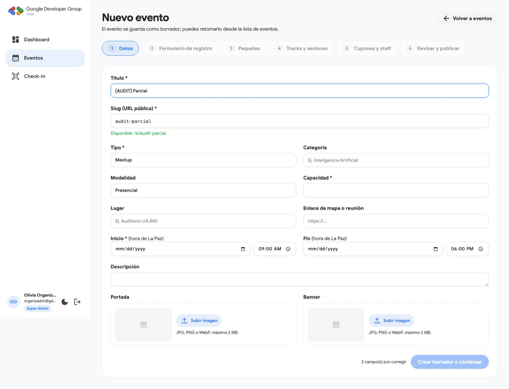 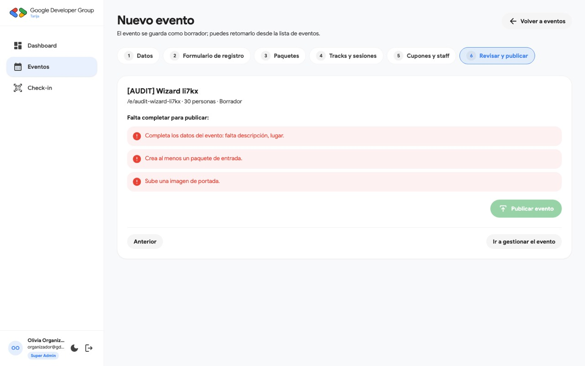
- **Ubicación:** `event-basics-form.html:258-266` (Guardar deshabilitado, solo "N campo(s) por corregir"); `publish-checklist.html:11-23` (faltantes sin enlace); `postgres-error.mapper.ts:73-77` (devuelve `error.message` crudo del servidor).
- **Impacto:** el recorrido 1 lo confirma: con solo el título, el botón sigue gris y no aparece ningún error. Al llegar a Revisar, "Publicar evento" está deshabilitado y el checklist dice "falta descripción, lugar" sin llevar a ninguna parte. Descripción y Lugar son necesarios para publicar, pero el paso 1 no los marca con `*`: el recorrido 1 no pudo publicar hasta volver atrás. Jordan se queda sin saber qué hacer.
- **Arreglo:** no deshabilitar el envío. Validar al pulsar, enfocar el primer campo inválido y nombrar los campos. Cada ítem del checklist lleva un "Ir a …". Mensaje genérico en español en vez de `error.message`. Marcar en la UI qué es "necesario para publicar" y qué es opcional.
- **Comando:** `/impeccable clarify`.
- **PR:** `fix/formularios-eventos` (C).

#### [P2] FO-6 · Terminología inconsistente y Despublicar sin confirmación

- **Captura:** 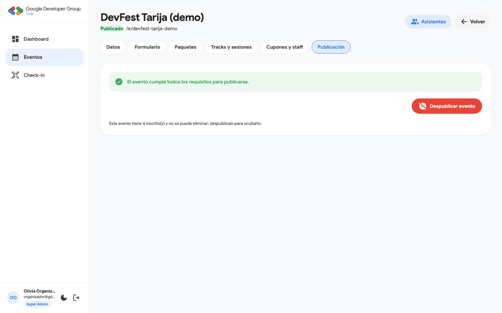
- **Ubicación:** `ticket-types-editor.html:6` ("Tipos de entrada" vs "Paquetes"), `:97` y `:326` ("inscrito(s)" vs "vendido(s)"); "Cupo" vs "Capacidad"; pestaña "Formulario" vs paso "Formulario de registro"; "Track" y "Slug" sin glosa.
- **Impacto:** `PRODUCT.md` pide un concepto, un nombre. Además, "Despublicar evento" con 4 inscritos se ejecuta de un toque, sin confirmación ni aviso de impacto.
- **Arreglo:** glosario único (propuesta: Capacidad = evento, Cupo = paquete o fase) aplicado a etiquetas, hints y errores. Confirmación con conteo al despublicar.
- **Comando:** `/impeccable clarify`, `/impeccable polish`.
- **PR:** `fix/formularios-eventos` (C).

#### [P2] FO-7 · Credenciales y controles nativos sin adaptar

- **Captura:** 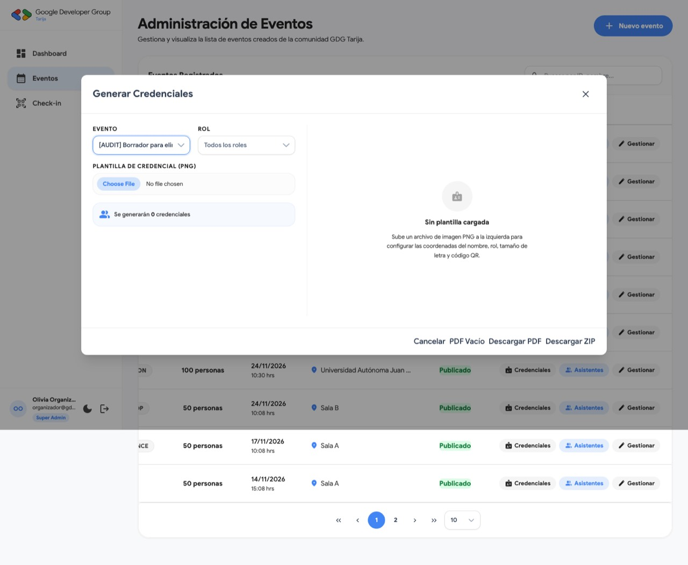
- **Ubicación:** `credential-generator.html` (file input nativo; footer con 4 acciones del mismo peso).
- **Impacto:** el `<input type=file>` aparece en inglés ("Choose File"), las fechas nativas muestran "mm/dd/yyyy" y "09:00 AM" en una interfaz es-BO, y ninguna de las 4 acciones del footer es la primaria. Hay un 403 en consola al abrir Cupones y staff como superadmin (por revisar con la base actual).
- **Arreglo:** botón de subida propio con texto en español; fechas con `p-datepicker` localizado (depende de BV-2); una acción primaria y las demás secundarias.
- **Comando:** `/impeccable polish`.
- **PR:** `fix/formularios-eventos` (C).

#### [P2] FO-8 · Reordenar fases falla recién al guardar, con el error fuera de vista

- **Captura:** 
- **Ubicación:** `src/app/features/events/presentation/components/ticket-types-editor/ticket-types-editor.html` (editor de fases, error bajo el campo Cupo).
- **Impacto:** reordenar deja la primera fase sin cupo. Guardar parece disponible, pero al pulsarlo el diálogo sigue abierto y Guardar se deshabilita. El mensaje "Solo la última fase puede quedar sin cupo." aparece bajo un campo dentro del cuerpo con scroll, y el pie no lo menciona. El usuario ve un botón gris sin motivo.
- **Arreglo:** validar al reordenar, no al guardar; resumen de errores junto al botón Guardar con enlace al campo; sacar el aviso del scroll.
- **Comando:** `/impeccable harden`, `/impeccable clarify`.
- **PR:** `fix/formularios-eventos` (C).

### 4.2 Navegación e IA

#### [P1] NA-1 · El menú móvil no es accesible

- **Captura:** 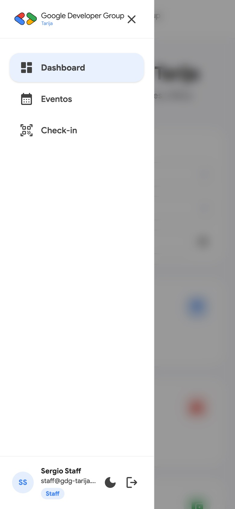
- **Ubicación:** `src/app/layouts/admin-layout/admin-layout.html:3-7` (aside), `:127-132` (backdrop).
- **Impacto:** cerrado, el aside está en `left:-256` pero sigue `visible`, sin `inert` ni `aria-hidden`, con 6 controles enfocables fuera de pantalla. Al abrirlo el foco no entra, Escape no lo cierra y no hay `role="dialog"`. Verificado en 4 combinaciones rol×tema. WCAG 2.1.1, 2.4.3, 4.1.2.
- **Arreglo:** `inert` mientras está cerrado; al abrir, foco al primer enlace; Escape y backdrop cierran y devuelven el foco a "Abrir menú"; `role="dialog" aria-modal="true" aria-label="Menú"` solo mientras es overlay.
- **Comando:** `/impeccable harden`.
- **PR:** `fix/ui-base` (A).

#### [P1] NA-2 · El STAFF aterriza en métricas financieras

- **Captura:** 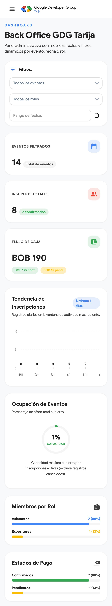
- **Ubicación:** `src/app/app.routes.ts:6-10,48` (todo redirige a `dashboard`); `admin-layout.html:28-56` (los mismos 3 ítems para ambos roles); `:142-148` (hamburguesa de 36 px).
- **Impacto:** contradice "el staff resuelve cada ingreso en segundos y con una mano". Su primera pantalla es "Flujo de Caja" y "Miembros por Rol", con ~2.000 px de scroll, y Check-in queda a dos toques detrás de un botón arriba a la izquierda, lejos del pulgar.
- **Arreglo:** redirección por rol (STAFF → `/checkin`, SUPERADMIN → `/dashboard`); ocultar o degradar Dashboard para STAFF; en móvil, acceso fijo a Check-in al alcance del pulgar (barra inferior).
- **Comando:** `/impeccable adapt`, `/impeccable distill`.
- **PR:** `fix/navegacion-eventos` (D). La barra inferior de check-in coordina con `fix/checkin-movil` (F).

#### [P1] NA-3 · La navegación no tiene nombre ni estado, y la app no tiene títulos por ruta

- **Ubicación:** `admin-layout.html:27-56` (`<nav>` sin `aria-label`, sin `ariaCurrentWhenActive`; iconos sin `aria-hidden` en `:34,44,54`); `src/index.html:5` (un único `<title>`, sin `TitleStrategy` ni `title:` en rutas); sin `<main>` ni skip link; `dashboard.html` salta de h1 a h3.
- **Impacto:** un lector de pantalla lee el nombre de la ligadura: "dashboardDashboard", "calendar_monthEventos". Nada marca el enlace activo. Lo mismo ocurre en las acciones de fila de `/events` ("groupAsistentes", "editGestionar"). La pestaña del navegador dice siempre "Back Office GDG Tarija".
- **Arreglo:** `aria-label="Principal"`, `ariaCurrentWhenActive="page"`, `aria-hidden="true"` en los `material-symbols-rounded`, `title` por ruta con `TitleStrategy`, `<main id>` con skip link y h2 reales.
- **Comando:** `/impeccable harden`.
- **PR:** `fix/ui-base` (A).

#### [P1] NA-4 · En la lista de eventos, Estado y Acciones quedan fuera de pantalla

- **Captura:** 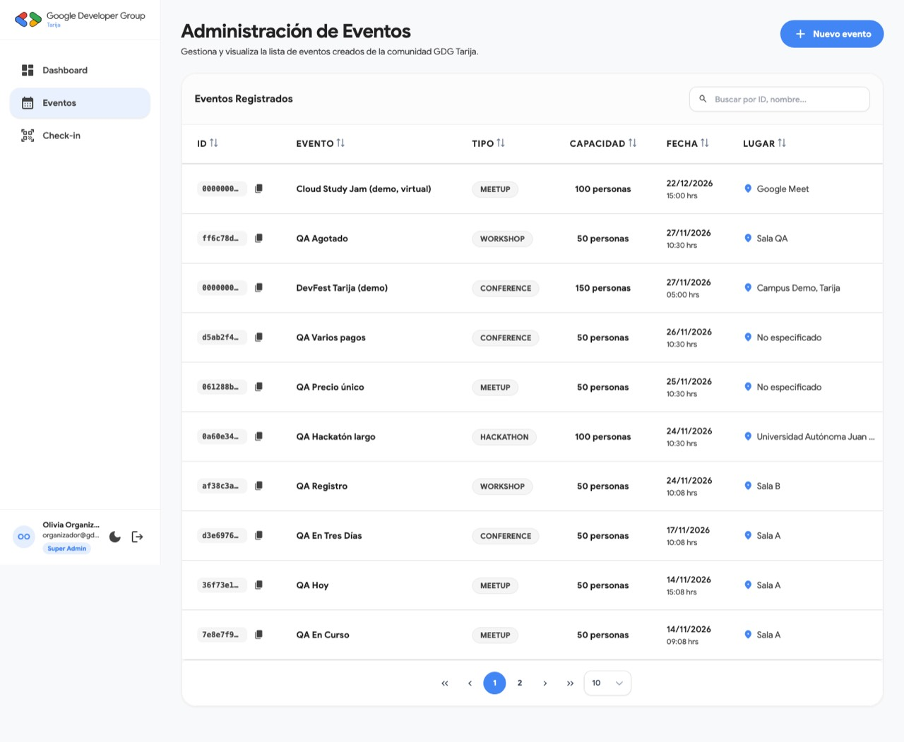 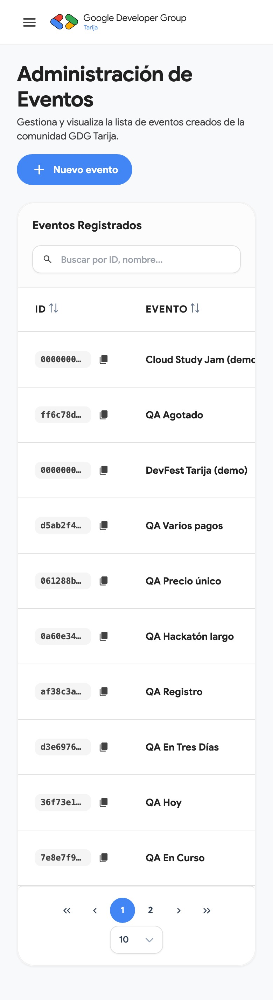
- **Ubicación:** `EV:59` (`min-width: 64rem`); columna ID en `EV:86,119`.
- **Impacto:** a 1440 px la tabla termina en "Lugar", sin Estado ni los botones Credenciales, Asistentes y Gestionar. En móvil solo caben ID y Evento. El único camino a Asistentes es una columna invisible. (La crítica de operación lo propuso como P0; se verificó que hay scroll horizontal, por eso P1.)
- **Arreglo:** bajo `md`, fila → tarjeta (nombre, estado, fecha, un botón "Gestionar"); en desktop quitar la columna ID para que Estado y Acciones entren a 1280 px; tipos de evento en español.
- **Comando:** `/impeccable adapt`.
- **PR:** `fix/navegacion-eventos` (D).

#### [P2] NA-5 · Acceso denegado sin salida y sin deep link tras login

- **Captura:** 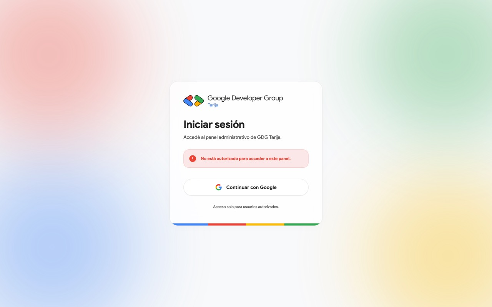
- **Ubicación:** `src/app/core/guards/auth.guard.ts:18`, `callback.ts:28`, `auth.service.ts:142,172`, `login.html:62-64`; voseo en `login.html:13` ("Accedé") frente al tuteo del resto.
- **Impacto:** el mensaje existe en tres variantes y ninguna dice a quién pedir acceso, así que Jordan (staff nuevo) se queda atascado. Quien llega por un enlace a `/events/xyz` cae en el login, pero no se ha comprobado que vuelva a ese destino después. La raíz y `**` siempre van a `/dashboard`.
- **Arreglo:** un único mensaje con contacto ("Pide acceso a un organizador de GDG Tarija"); conservar `returnUrl` hasta el callback; tuteo en todo el texto.
- **Comando:** `/impeccable clarify`.
- **PR:** `fix/navegacion-eventos` (D).

#### [P3] NA-6 · Textos de la lista de eventos

- **Ubicación:** `EV:5-10` (título y subtítulo largos empujan la tabla), `EV:76` (placeholder "Buscar por ID"), `EV:147` ("100 personas" repetido), `EV:222-224` (estado vacío que sugiere "registra eventos en la base de datos").
- **Impacto:** ruido y orientación equivocada para quien no es técnico.
- **Arreglo:** placeholder "Buscar por nombre o lugar", estado vacío con acción "Crear evento", cabecera más corta.
- **Comando:** `/impeccable clarify`.
- **PR:** `fix/navegacion-eventos` (D).

### 4.3 Asistentes y pagos

#### [P1] AS-1 · La tabla de asistentes es ilegible fuera del desktop ancho

- **Captura:** 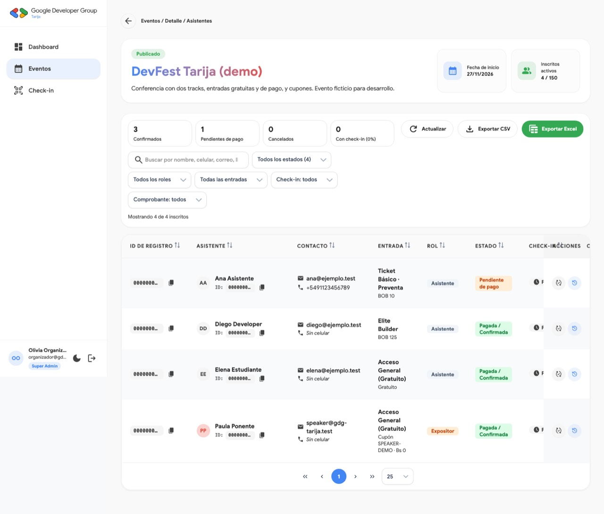 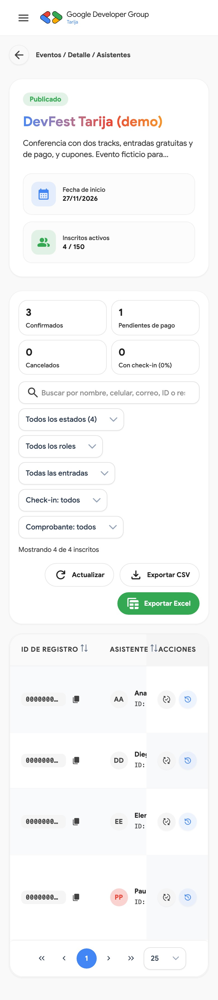
- **Ubicación:** `AT:315` (`min-width: 95rem`); `attendees-page.scss:11-16` (`::ng-deep` global).
- **Impacto:** las cabeceras "CHECK-IN" y "ACCIONES" se pisan en desktop y en móvil solo se ve el inicio de la fila. Las respuestas dinámicas ensanchan la tabla (`AT:332-336`). Es la pantalla donde se revisan los pagos, y `PRODUCT.md` dice que se hace desde el celular.
- **Arreglo:** fila → tarjeta bajo `md` (nombre, estado de pago, entrada, botón "Revisar"); cola de "Pendientes de pago" con el comprobante a mano; en desktop, menos columnas por defecto.
- **Comando:** `/impeccable adapt`, `/impeccable distill`.
- **PR:** `fix/asistentes` (E).

#### [P2] AS-2 · Un concepto, varios nombres y colores de estado

- **Ubicación:** `AT:138` ("Cancelados"), `registration-status.ts:52-53` ("Anulada/Anulados"), `attendee-search.ts:115` ("Cancelado"), `checkin.api.ts:210`; "Pagada" y "Confirmada". Los estados se colorean con `bg-google-*-light/60` más `dark:` a mano en lugar de tokens.
- **Impacto:** el organizador no sabe si "Cancelado" y "Anulada" son lo mismo. Los chips fallan contraste (verde 2,6:1, azul 3,05:1, amarillo 1,5:1).
- **Arreglo:** `registration-status.ts` como única fuente de nombre, color y rol (Confirmada / Pendiente de pago / Anulada), con colores accesibles del preset.
- **Comando:** `/impeccable clarify`, `/impeccable colorize`.
- **PR:** `fix/asistentes` (E).

#### [P2] AS-3 · Filtros y exportación sin jerarquía, y el filtro no queda en la URL

- **Captura:** 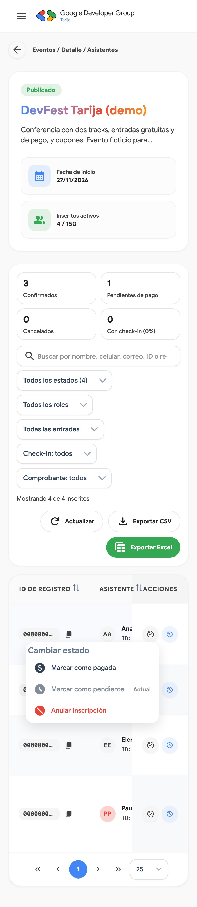
- **Ubicación:** `AT:255-290` (5 selects + búsqueda + Actualizar/CSV/Excel); `AT:146-150` (KPI como filtro).
- **Impacto:** en móvil, filtros y KPI ocupan la pantalla antes de la primera fila. El menú de estado tapa la fila y no dice a quién cambia el estado. Si recargas, pierdes el filtro. STAFF ve la tabla sin acciones ni explicación de "solo lectura".
- **Arreglo:** una fila "Filtros (n)" que abre un panel; filtros en la URL; "Exportar" como menú; destacar "Pendientes de pago"; mensaje de solo lectura para STAFF.
- **Comando:** `/impeccable distill`, `/impeccable layout`.
- **PR:** `fix/asistentes` (E).

#### [P2] AS-4 · En móvil, "Confirmar pago" queda bajo el pliegue del comprobante

- **Captura:** 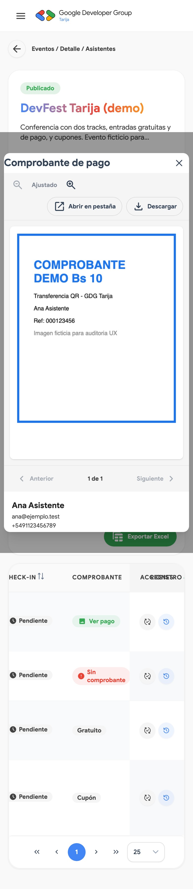
- **Ubicación:** `src/app/features/events/presentation/components/payment-proof-dialog/payment-proof-dialog.html:93` y el pie del diálogo.
- **Impacto:** el recorrido 2 mide "Confirmar pago visible sin scroll" = sí en desktop y **no** en móvil. Confirmar un pago desde el celular exige desplazarse dentro del diálogo.
- **Arreglo:** pie del diálogo fijo con la acción primaria; imagen con altura máxima y zoom; nombre del asistente y monto arriba.
- **Comando:** `/impeccable adapt`.
- **PR:** `fix/asistentes` (E).

#### [P3] AS-5 · Título con degradado

- **Ubicación:** `AT:73` (`bg-gradient-to-r … bg-clip-text text-transparent`); detector `gradient-text`, verdadero positivo.
- **Impacto:** el contraste del título depende del degradado y desaparece en `forced-colors`. Con los pesos que realmente se cargan, `font-extrabold` tampoco se ve como se escribió.
- **Arreglo:** título en color sólido. Quitar también las tarjetas anidadas (5 `nested-cards` en asistentes y check-in).
- **Comando:** `/impeccable quieter`.
- **PR:** `fix/asistentes` (E).

### 4.4 Check-in

#### [P1] CI-1 · Demasiados pasos antes de la cámara, y el evento por defecto es arbitrario

- **Captura:** 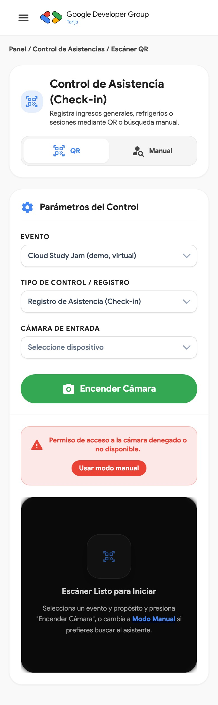
- **Ubicación:** `CK` y `checkin-page.ts:97-99,116,213`. Tres selects (Evento, Tipo, Cámara) antes de "Encender cámara". Evento por defecto = `data[0]`, o sea el último por fecha.
- **Impacto:** la puerta es la tarea con más prisa. Hay que tocar y decidir tres cosas antes de escanear, el banner rojo "Permiso denegado" aparece al cargar y no tras pulsar, y el evento preseleccionado es el más lejano de la lista, ordenada por fecha descendente: "Cloud Study Jam (demo, virtual)" para STAFF y, para SUPERADMIN, un borrador del 30/12. En el recorrido 3 hubo que cambiarlo a mano. La búsqueda manual queda bajo el pliegue.
- **Arreglo:** preseleccionar el evento de hoy o en curso (o el único asignado) y recordar el último usado; parámetros en una barra de una línea; error de cámara solo tras pulsar; buscador arriba; acciones en la zona del pulgar; objetivos de 44 px.
- **Comando:** `/impeccable distill`, `/impeccable harden`.
- **PR:** `fix/checkin-movil` (F).

#### [P1] CI-2 · El resultado del ingreso no es un semáforo

- **Captura:** 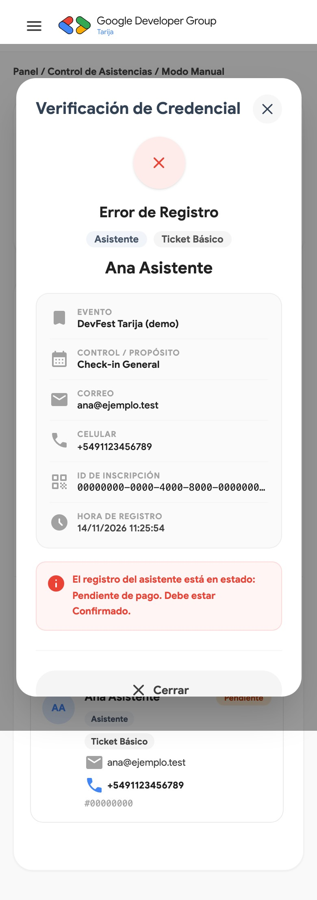
- **Ubicación:** `checkin-page.html`, `checkin.api.ts:210`, `checkin-page.scss:64,74,95`.
- **Impacto:** un modal con 6 filas de datos y el motivo al final. El título es "Error de Registro" para un pago pendiente, "Ya registrado" no se distingue de un error y el mensaje ("Debe estar Confirmado") dice qué pasó, no qué hacer. Los botones del modal podrían quedar cortados (por confirmar). En tema oscuro el modal pierde sus estilos (BV-8).
- **Arreglo:** resultado a pantalla completa con color e icono grandes, nombre y una línea de acción ("Pago pendiente: pide el comprobante o avisa a un organizador"); detalle bajo "Ver detalle"; contador "dentro / esperados".
- **Comando:** `/impeccable clarify`, `/impeccable layout`.
- **PR:** `fix/checkin-movil` (F).

#### [P2] CI-3 · Check-in manual: errores que se descubren tarde

- **Captura:** 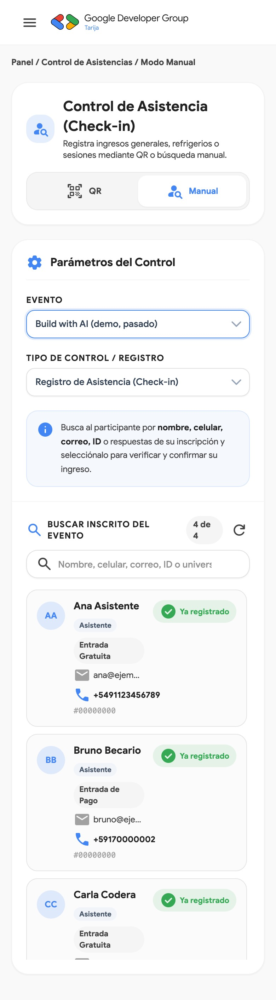
- **Ubicación:** `CK:7` ("Control de Asistencias" frente al título "Control de Asistencia (Check-in)"); filas "Pendiente de pago" seleccionables.
- **Impacto:** una fila sin pago se puede tocar y solo falla en el modal. El enlace "Usar modo manual" es `py-1.5 text-xs`. El éxito rebota con `cubic-bezier(0.34, 1.56, 0.64, 1)`, algo ruidoso para un tono utilitario.
- **Arreglo:** marcar o desactivar las filas pendientes con la razón visible; un nombre único para la pantalla; modos QR y Manual como pestañas grandes.
- **Comando:** `/impeccable clarify`, `/impeccable polish`.
- **PR:** `fix/checkin-movil` (F).

### 4.5 Dashboard

#### [P2] DA-1 · Plantilla genérica en vez de "qué requiere mi atención hoy"

- **Captura:** 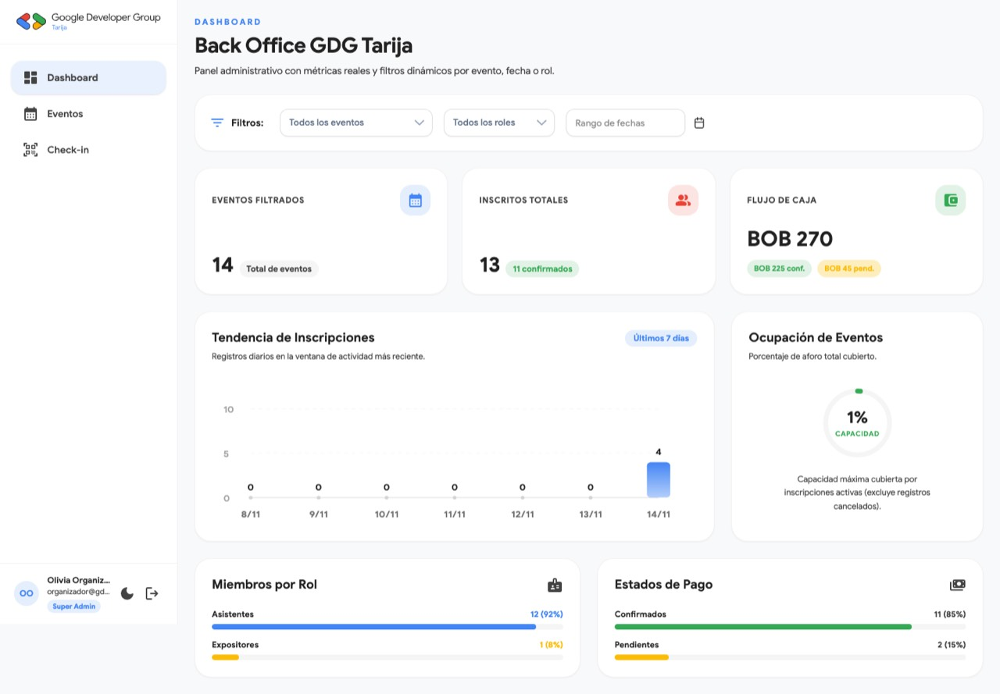
- **Ubicación:** `dashboard.html` (seis widgets del mismo peso, `rounded-3xl p-6`), `dashboard.html:9-11` (subtítulo que describe la herramienta).
- **Impacto:** no refleja la operación de GDG Tarija: ni próximo evento, ni pagos por revisar, ni check-in en curso. Las métricas "Miembros por Rol" u "Ocupación 1%" no llevan a ninguna decisión.
- **Arreglo:** franja de acción arriba (pagos pendientes, próximo evento, check-in en curso) y las métricas debajo; variante por rol.
- **Comando:** `/impeccable layout`, `/impeccable distill`.
- **PR:** `fix/dashboard` (G).

#### [P2] DA-2 · El gráfico "Últimos 7 días" recorta el día más reciente en móvil

- **Ubicación:** `dashboard.html:81-83` (`min-w-[400px]` con `overflow-x-auto scrollbar-none`); SVG sin alternativa textual (`:84-193`); región con scroll no enfocable (axe `scrollable-region-focusable`).
- **Impacto:** el dato más reciente queda cortado sin pista de scroll, y un lector de pantalla no obtiene ninguna cifra.
- **Arreglo:** gráfico ajustado al ancho con valores legibles y tabla o resumen textual equivalente.
- **Comando:** `/impeccable adapt`.
- **PR:** `fix/dashboard` (G).

#### [P3] DA-3 · Etiquetas y moneda

- **Ubicación:** `dashboard-metrics.html:4,7` ("Eventos Filtrados" con chip "Total de eventos"), `:25,33,38` ("BOB" en lugar de "Bs"; en asistentes conviven "BOB 125" y "Bs 0", y en paquetes "Bs 15.00"); `dashboard.html:6-8` (el H1 repite el nombre de la app); `dashboard-filters.html` (`p-select` y `p-datepicker` sin label ni `ariaLabel`).
- **Impacto:** `PRODUCT.md` pide "Bs". Los filtros no tienen nombre accesible.
- **Arreglo:** "Bs" en todo el dashboard, H1 "Resumen", labels en filtros.
- **Comando:** `/impeccable clarify`.
- **PR:** `fix/dashboard` (G).

### 4.6 Base visual y accesibilidad

#### [P1] BV-1 · Las capas CSS están al revés: PrimeNG gana a Tailwind

- **Ubicación:** `src/styles.scss:8` (`@layer tailwind, primeng;`), `src/app/app.config.ts:24` (`cssLayer: { name: 'primeng', order: 'tailwind, primeng' }`).
- **Impacto:** el CSS compilado empieza con `@layer theme, base, components, utilities;` y después `tailwind, primeng`. El orden efectivo deja a `primeng` por encima de `utilities`. Resultado medido: 208 utilidades con `!` en plantillas y 255 `!important` en SCSS (`styles.scss` 119, `events-page.scss` 70, `checkin-page.scss` 34, `attendees-page.scss` 32). Una utilidad nueva sin `!` "no hace nada" en un componente PrimeNG.
- **Arreglo:** `@layer theme, base, primeng, components, utilities;` una sola vez antes de `@use 'tailwindcss'`, `cssLayer: { name: 'primeng' }` sin `order`, y quitar los `!` por lotes. Los overrides globales pasan a `@layer components`.
- **Comando:** `/impeccable polish` tras el ajuste, y `/impeccable harden`.
- **PR:** `fix/ui-base` (A).

#### [P1] BV-2 · Sin locale `es` ni traducción de PrimeNG

- **Ubicación:** `src/app/app.config.ts` (sin `translation` en `providePrimeNG`, sin `LOCALE_ID`); `dashboard-filters.html:49` (`dateFormat="dd/mm/yy"`).
- **Impacto:** el calendario del dashboard muestra "November 2026" y Su/Mo/Tu (confirmado en vivo), más aria-labels internos ("Close", "Next Month"), "No results found", paginador y `confirmdialog` en inglés. Los pipes `date` y `currency` usan `en-US`.
- **Arreglo:** `providePrimeNG({ translation: es })` con `firstDayOfWeek: 1`, y `LOCALE_ID` `es` con `registerLocaleData`.
- **Comando:** `/impeccable harden`.
- **PR:** `fix/ui-base` (A).

#### [P1] BV-3 · Etiquetas no vinculadas a `p-select`, `p-inputnumber` y `p-datepicker`

- **Ubicación:** `credential-generator.html:19-29,130-165,228-248,270-275,316-335`; `checkin-page.html:94-106,115-120,146,171-176`. En toda la app hay 0 `inputId`, con 16 `p-select`, 13 `p-inputnumber` y 1 `p-datepicker`.
- **Impacto:** el `id` queda en el host, no en el input interno. El lector anuncia "combobox" sin nombre y clicar la etiqueta no enfoca el control. Axe: `label-content-name-mismatch` ×34. WCAG 1.3.1, 3.3.2, 4.1.2.
- **Arreglo:** `inputId` y `ariaLabelledBy`. Se define el patrón en el PR base y cada PR de pantalla lo aplica.
- **Comando:** `/impeccable harden`.
- **PR:** `fix/ui-base` (A) define el patrón; C, F y G lo aplican en sus pantallas.

#### [P1] BV-4 · Botones sin nombre accesible e iconos leídos como texto

- **Ubicación:** axe `button-name` crítico ×22: `.p-ripple` en los modales de check-in, `.p-button-icon-only` en credenciales, `.p-button` en detalle y comprobante. 132 `<button>` frente a 81 `aria-label`. 124 usos de `material-symbols-rounded` sin `aria-hidden`.
- **Impacto:** el botón de cerrar de los diálogos no tiene nombre; con ligaduras, el nombre es "close" o "groupAsistentes". En la puerta el staff depende de esos modales.
- **Arreglo:** `aria-label` en todos los botones de icono y `aria-hidden="true"` en el icono. Crear un componente `app-icon` que lo haga por defecto.
- **Comando:** `/impeccable harden`.
- **PR:** `fix/ui-base` (A); el cierre de diálogos en `fix/dialogos` (B).

#### [P1] BV-5 · Contraste por debajo de AA en la paleta Google

- **Ubicación:** chips `size-9 bg-google-blue-light/60 dark:bg-google-blue/20`, `bg-google-green-light/60`, `tracking-[0.2em]` del dashboard, CTA blanco sobre `#4285f4`.
- **Impacto:** axe marca `color-contrast` ×150. Medido: chip amarillo 1,5:1, verde 2,6:1, azul 3,05:1, kicker 3,4:1, placeholder 2,6–3,2:1, CTA y paginador 3,6:1, botón rojo 3,9:1. Al sol, en la puerta, es ilegible. WCAG 1.4.3.
- **Arreglo:** variantes oscuras para texto (`text-google-*-dark` sobre pastel), azul de acción más oscuro en el preset, token de placeholder ≥ 4,5:1.
- **Comando:** `/impeccable colorize`.
- **PR:** `fix/ui-base` (A).

#### [P1] BV-6 · Aura sin personalizar: verde esmeralda en los componentes PrimeNG

- **Ubicación:** `src/app/app.config.ts:22` (`preset: Aura`, sin `definePreset`).
- **Impacto:** Aura trae `primary` esmeralda y la marca es azul Google. Los overrides de `styles.scss` corrigen foco de `.p-select` y `.p-inputtext`, pero checkboxes, toggles, paginador, progressbar, tag, tabs y `p-button` sin `gdg-btn-*` heredan el verde. Conviven dos acentos (196 usos de `p-button`, `severity` o `bg-primary`). No se fotografió un control esmeralda en vivo; se confirmó por código.
- **Arreglo:** `definePreset(Aura, { semantic: { primary, colorScheme } })` alimentado por los tokens existentes, y borrar los overrides redundantes.
- **Comando:** `/impeccable colorize`, `/impeccable document`.
- **PR:** `fix/ui-base` (A).

#### [P2] BV-7 · `::ng-deep` global que depende del orden de carga

- **Ubicación:** `events-page.scss:27`, `attendees-page.scss:18` (los de `checkin-page.scss:22` y `credential-generator.scss:1,17` sí usan `:host`).
- **Impacto:** `.overflow-x-auto { display:block !important }` y las `p-datatable` cambian de comportamiento en toda la sesión una vez visitado `events` o `attendees`.
- **Arreglo:** envolver con `:host` o mover a `@layer components` con una clase propia.
- **Comando:** `/impeccable polish`.
- **PR:** `fix/ui-base` (A).

#### [P2] BV-8 · Selectores y variables de tema que no existen

- **Ubicación:** `checkin-page.scss:74` (`.dark …`) y `:64` (`var(--text-secondary)`); 7 usos de `dark:bg-neutral-850` (p. ej. `dashboard.html:196,283,319`).
- **Impacto:** el tema usa `data-theme="dark"`, nunca la clase `.dark`, así que el modal de confirmar check-in no recibe estilos oscuros. `--text-secondary` no existe (el token es `--color-text-secondary`). `neutral-850` no existe en Tailwind v4: las barras de progreso no tienen pista en oscuro.
- **Arreglo:** usar `[data-theme='dark']`, el token correcto y `neutral-800`; aplicar el tema con un script temprano en `index.html` para evitar el parpadeo al cargar.
- **Comando:** `/impeccable harden`.
- **PR:** `fix/ui-base` (A).

#### [P2] BV-9 · Sistema de tokens duplicado y dark mode escrito a mano

- **Ubicación:** `styles.scss:11-18` (`--color-google-*`) frente a `_variables.scss:8-15` (`--gdg-google-*`); `styles.scss:20-23` (autorreferencias en `@theme`); 730 `dark:` en plantillas.
- **Impacto:** hay dos sistemas de azules. Las autorreferencias (`--color-surface-main: var(--color-surface-main)`) solo funcionan porque `:root` sin capa les gana; si se reordena el CSS, desaparece todo el texto. Unas 24 variables nunca se usan (`text-tertiary`, `badge-*`, `price-*`, `login-*`…). Cambiar un color implica tocar cientos de líneas. Hay hex sueltos (`#0a0a0a`, `#171717`, `#1a1a1a`, `#e8e8e8`).
- **Arreglo:** una sola familia de tokens semánticos, sin muertos ni autorreferencias, documentada; migrar los `dark:` repetidos a tokens que cambian solos.
- **Comando:** `/impeccable document`, `/impeccable colorize`.
- **PR:** `chore/ui-pulido` (H). La parte mínima para no romper al reordenar capas va en A.

#### [P2] BV-10 · Pesos tipográficos que no se cargan

- **Ubicación:** `styles.scss:48-94` (solo 400, 500 y 700). Uso: `font-semibold` ×194, `font-bold` ×126, `font-medium` ×93, `font-extrabold` ×15, `font-black` ×1.
- **Impacto:** 600, 800 y 900 se resuelven a 700, por lo que 336 usos de "negrita" son idénticos. La jerarquía que expresa el código no existe en pantalla.
- **Arreglo:** decidir los pesos (cargar 600 o mapear a 500/700) y usarlos con intención.
- **Comando:** `/impeccable typeset`.
- **PR:** `fix/ui-base` (A).

#### [P2] BV-11 · Carga de iconos e imágenes

- **Ubicación:** `src/index.html:11-14` (Material Symbols con los 4 ejes variables y sin `display`); `styles.scss:3` (PrimeIcons importado y casi sin uso: 6 coincidencias); 11 `` sin `loading` ni dimensiones (`admin-layout.html:13,65,150`, `attendees-page.html:387,696`, `payment-proof-dialog.html:93`).
- **Impacto:** mientras carga la fuente se ve el nombre de la ligadura como texto, y los listados piden los comprobantes completos como miniaturas.
- **Arreglo:** pedir solo los ejes necesarios y `&display=block`, quitar PrimeIcons o mapearlos, `loading="lazy"`, `width` y `height`.
- **Comando:** `/impeccable optimize`.
- **PR:** `chore/ui-pulido` (H).

#### [P2] BV-12 · Sin `prefers-reduced-motion` y animaciones infinitas en el login

- **Ubicación:** `auth-layout.scss` (4 orbes `infinite alternate` con `blur(95px)`), `styles.scss:30,176`, `login.scss:11`, `checkin-page.scss:88-103`.
- **Impacto:** 0 coincidencias de `prefers-reduced-motion` en `src/`. Malestar vestibular y coste de GPU en móviles modestos, justo en la pantalla de entrada. WCAG 2.2.2.
- **Arreglo:** media query que congele los orbes y sustituya las entradas por fundidos.
- **Comando:** `/impeccable animate`, `/impeccable optimize`.
- **PR:** `chore/ui-pulido` (H).

#### [P2] BV-13 · Objetivos táctiles y texto por debajo del mínimo

- **Ubicación:** botones de tema y cerrar sesión de 32 px, pegados y sin confirmar (`admin-layout.html:100,113`); `size-8` en `ticket-types-editor.html:341,352`; inputs de 40 px; 72 usos de `text-[9px]/[10px]/[11px]` ("Super Admin" a 10 px, `login.html:62` a 11 px).
- **Impacto:** el staff opera con una mano; el rango de 14 a 73 objetivos por pantalla bajo 44 px (según la pantalla) hace fácil un toque erróneo, y cerrar sesión por error no tiene vuelta atrás.
- **Arreglo:** mínimo 44 px en acciones táctiles, texto mínimo de 12 px, separar cerrar sesión del tema. Cada PR de pantalla corrige los suyos.
- **Comando:** `/impeccable adapt`, `/impeccable typeset`.
- **PR:** `chore/ui-pulido` (H); el shell en `fix/ui-base` (A).

#### [P3] BV-14 · Pulido de animación y rendimiento

- **Ubicación:** `transition-all` (13 en `checkin-page.html`, 11 en `attendees-page.html`, raíz de `admin-layout.html:1` y `dashboard.html:1`); `backdrop-blur` en `dialog-frame.html:2` y `login.scss`; `animate-fade-in` definida solo en `checkin-page.scss:7`; `ButtonModule` sin uso en `admin-layout.ts:4`; `hover:bg-red-500` fuera de la paleta GDG.
- **Impacto:** animar `all` incluye propiedades de layout; el diálogo no anima fuera de check-in.
- **Arreglo:** `transition-colors/opacity/transform`, quitar el blur, mover `fade-in` a estilos globales.
- **Comando:** `/impeccable optimize`, `/impeccable animate`.
- **PR:** `chore/ui-pulido` (H).

---

## 5. Lo que funciona

Conviene conservarlo tal cual.

1. **Mensajes de validación en español que dicen qué pasó y cómo seguir** (`event-validators.ts:126-185`), y el slug con estado "Disponible" en verde.
2. **Accesibilidad a nivel de campo en formularios:** labels asociados (0 inputs sin label), `aria-invalid`, `role="alert"`, `fieldset/legend` en fechas, 0 errores de consola.
3. **Cuidado con datos ajenos:** slug bloqueado con inscritos, borrado diferido de imágenes, "Eliminar evento" exige teclear el slug.
4. **Cambio de estado de inscripción:** confirmación solo en lo destructivo, bloqueo de doble envío, toast, opción "Actual" deshabilitada (`registration-status-controller.ts:61-119`).
5. **Aria-labels de icono con el nombre del asistente** (`AT:602-607,627`).
6. **Check-in con intención operativa:** QR y Manual en una página, cámara trasera por defecto (`checkin-page.ts:200-208`), tres sonidos (éxito, aviso, error) y cierre automático.
7. **`p-dialog` de check-in, credenciales, detalle y comprobante** pasan el harness de foco: sirven de modelo para `DialogFrame`.
8. **Marca coherente:** logo, barra de cuatro colores del login, Google Sans autoalojada con `font-display: swap`, tokens de superficie y texto, tema claro y oscuro persistido, `lang="es"`.
9. **Arquitectura:** features con lazy loading (7 rutas), zoneless y signals, solo 4 `any`, guardas de ruta que cierran sesión y redirigen con seguridad.
10. **Footer del shell** con avatar, nombre, correo y rol siempre visibles, y navegación de ida y vuelta Eventos → Gestionar → Asistentes → Check-in sin perder contexto.
11. **Login, dashboard, check-in y listados no desbordan** en móvil: el problema está solo en el flujo de evento.

---

## 6. Backlog priorizado

Esfuerzo: **S** ≈ medio día, **M** ≈ 1–2 días, **L** ≈ 3 o más días.

| Orden | PR                            | Hallazgos                                                                           | Severidad máxima | Esfuerzo | Dependencias                                                             |
| ----- | ----------------------------- | ----------------------------------------------------------------------------------- | ---------------- | -------- | ------------------------------------------------------------------------ |
| 1     | `fix/ui-base` (A)             | BV-1, BV-2, BV-3, BV-4, BV-5, BV-6, BV-7, BV-8, BV-10, NA-1, NA-3, FO-3 (`min-w-0`) | P1               | L        | Ninguna. Va primero: los demás se apoyan en capas, locale y preset.      |
| 2     | `fix/dialogos` (B)            | FO-2, BV-4 (cierre de diálogos)                                                     | P1               | M        | A (capas y `aria-hidden`). Decisión Q2.                                  |
| 3     | `fix/formularios-eventos` (C) | FO-1, FO-3 (stepper y pestañas), FO-4, FO-5, FO-6, FO-7, FO-8, BV-3 (aplicado)      | **P0**           | L        | B (confirmar descarte), A (locale). Decisión Q1.                         |
| 4     | `fix/navegacion-eventos` (D)  | NA-2, NA-4, NA-5, NA-6                                                              | P1               | M        | A. Decisión Q3.                                                          |
| 5     | `fix/asistentes` (E)          | AS-1, AS-2, AS-3, AS-4, AS-5                                                        | P1               | M        | A (preset y contraste), D (patrón de fila → tarjeta). Decisión Q5.       |
| 6     | `fix/checkin-movil` (F)       | CI-1, CI-2, CI-3, BV-3 (aplicado)                                                   | P1               | M        | A, D (acceso rápido del STAFF), AS-2 (nombres de estado).                |
| 7     | `fix/dashboard` (G)           | DA-1, DA-2, DA-3                                                                    | P2               | M        | A. Decisión Q4 (moneda).                                                 |
| 8     | `chore/ui-pulido` (H)         | BV-9, BV-11, BV-12, BV-13, BV-14                                                    | P2               | M        | Todos los anteriores. Incluye documentar el sistema y re-correr `audit`. |

Notas de reparto:

- **FO-3** (`min-w-0` en el layout) se reparte: el `min-w-0` del layout va en A (una línea que desbloquea el móvil) y el ajuste de stepper, pestañas y diálogos en C.
- **BV-3** y **BV-13** son transversales: A define el patrón y cada PR de pantalla lo aplica en lo suyo.
- **Sin asignar:** ninguno. Los puntos que no tienen dueño claro (tokens muertos, `neutral-850`, pesos de fuente) caben en A y H.

---

## 7. Preguntas abiertas para el equipo

1. **¿Cómo evitar perder el trabajo en el wizard? (FO-1, P0).**
   a) Borrador temprano con el paso en la URL y reanudar (recomendada).
   b) `sessionStorage` con aviso de salida.
   c) Eliminar el wizard y crear con datos mínimos, completando en la gestión.
2. **¿Qué hacemos con `DialogFrame`? (FO-2).**
   a) Reescribirlo sobre `<dialog>` nativo.
   b) Reemplazarlo por `p-dialog` en todos los editores (recomendada: ya funciona en 4 pantallas).
   c) Parchear rol, foco y Escape.
3. **¿Qué ve el STAFF al entrar, y cómo se elige el evento del check-in? (NA-2, CI-1).**
   a) STAFF va directo a `/checkin`, con Dashboard oculto (recomendada).
   b) Dashboard reducido a "mis eventos de hoy" con un botón grande de Check-in.
   c) Dashboard igual, con acceso fijo a Check-in en móvil.
   Para el evento por defecto: el de hoy o en curso, el único asignado, o el último usado en ese dispositivo.
4. **¿Qué vocabulario y tono usa el producto? (FO-6, AS-2, DA-3, NA-5).**
   a) Bs, tuteo, Capacidad (evento) y Cupo (paquete o fase), Confirmada / Pendiente de pago / Anulada (recomendada).
   b) BOB, voseo, "Plazas" para ambos, y "Cancelada".
   c) Decidirlo pantalla por pantalla.
   Si el acceso se deniega, ¿qué contacto se muestra: correo de un organizador, enlace al grupo de la comunidad, o solo "pide acceso a un organizador"?
5. **¿Qué alcance tiene el rediseño móvil de tablas y qué pasa con el estilo decorativo? (NA-4, AS-1, AS-5).**
   a) Fila → tarjeta en Eventos y en Asistentes (recomendada).
   b) Solo en Asistentes, donde están los pagos.
   c) Solo columnas visibles, sin tarjetas.
   Sobre el estilo: quitar el degradado del título y las tarjetas anidadas, o conservarlos como identidad.

Se tomarán por defecto y sin consulta estas decisiones menores, salvo objeción: confirmación con conteo al despublicar, un solo mensaje de acceso denegado, y `Escape` cerrando drawer y diálogos.

---

## 8. Tendencia: antes → después

| Medida                                               | Antes (2026-11-14) | Después   |
| ---------------------------------------------------- | ------------------ | --------- |
| Nielsen · Formularios                                | 22 / 40            | pendiente |
| Nielsen · Operación                                  | 24 / 40            | pendiente |
| Nielsen · Shell                                      | 19 / 40            | pendiente |
| Audit · Accesibilidad                                | 2 / 4              | pendiente |
| Audit · Rendimiento                                  | 3 / 4              | pendiente |
| Audit · Theming                                      | 2 / 4              | pendiente |
| Audit · Responsive                                   | 2 / 4              | pendiente |
| Audit · Integridad de implementación                 | 2 / 4              | pendiente |
| **Audit · Total**                                    | **11 / 20**        | pendiente |
| Hallazgos P0 / P1 / P2 / P3                          | 1 / 16 / 18 / 4    | pendiente |
| axe `color-contrast` (serious)                       | 150                | pendiente |
| axe `button-name` (critical)                         | 22                 | pendiente |
| axe `label-content-name-mismatch` (serious)          | 34                 | pendiente |
| Pantallas con desbordamiento horizontal (móvil)      | 24                 | pendiente |
| Diálogos `DialogFrame` sin `role="dialog"`           | 8 de 8             | pendiente |
| Utilidades con `!` en plantillas / `!important` SCSS | 208 / 255          | pendiente |
| Usos de `dark:` manuales                             | 730                | pendiente |

Para actualizar la columna "Después": re-correr el harness con la misma matriz y volver a lanzar `/impeccable critique` sobre las tres superficies y `/impeccable audit` sobre `src/app`.
